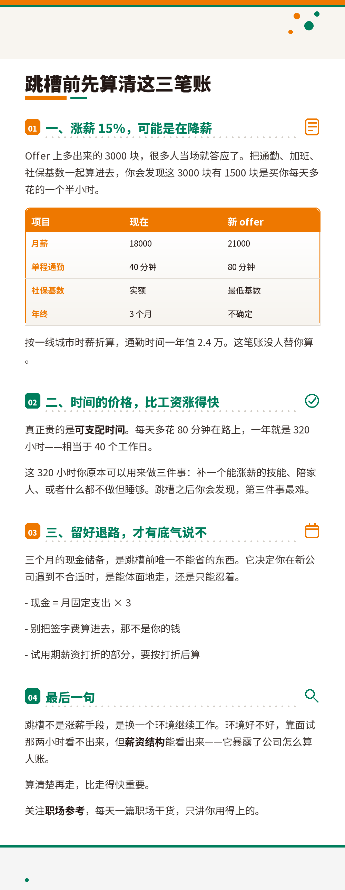

# wechat-daily

> **仓库位置提示**：本技能已迁入仓库子目录 `wechat-daily/`。克隆后请 `cd wechat-daily` 再按下方步骤操作；
> 技能目录整体拷贝到 `~/.workbuddy/skills/wechat-daily` 即可使用，包内路径均为相对路径，不受上层目录影响。

> **当前版本 V1.0**（2026-11-05；代码内容对应内部迭代 `v1.0.47`）｜变更记录见 [CHANGELOG.md](CHANGELOG.md)

一个**通用**的公众号日更自动化技能（Agent Skill）：从选题到成品图，一条流水线跑完每天 N 篇推文，并可自动存进公众号草稿箱。

**类目不预设**——「考公」只是仓库自带的示例。初始化时你定义自己的类目（职场 / 母婴 / 财经 / 宠物 / 家装……）、读者画像与主色，技能按你的设定产出。

写给这样的人：一个人运营一个公众号，每天要出多篇、还要做长图和封面，时间全花在排版上。

> 定位：这不是「AI 写文章」工具，而是一条**带质检的产线**——选题去重、去 AI 味、合规校验、封面判色，每道闸门都有脚本兜底，而不是靠模型自觉。

> **平台边界（先看这条）**：本技能在 **macOS** 上完整验证——出稿六步 + 第七步自动存草稿都可用。**Windows / Linux 只能到出稿为止**（Markdown / 长图 / 封面 / HTML 都能产出，草稿需手动粘贴），因为第七步依赖 ego lite 桌面端。平台选错不会立刻报错，会一路跑到第七步才失败。

---

## 效果预览

| 封面（900×383） | 长图（1000PX 宽，高度自适应） |
|---|---|
|  |  |

> 上图由仓库脚本直接生成，未做后期修图。
> 图里的 `职场参考` 是**示例号名**，只用于演示；右上角 `你的 LOGO` 是占位图，替换 `assets/logo.png` 即可换成自己的品牌。
> **代码默认值有意保持占位语气**（`WX_BRAND` 默认 `你的公众号`），避免有人拿到就直接用示例名发布。

---

## 它做什么

| 步骤 | 产出 | 关键约束 |
|---|---|---|
| 1. 选题 | N 个标题（E 篇泛干货 + S 篇专栏，N/E/S 由 Q15 自定义） | ≤20 字、禁用词自查、与历史选题相似度 ≥0.45 自动告警换角度 |
| 2. 创作 | N 篇正文（篇幅区间见规范文件） | 事实以官方公告为准；专栏必须带结构化内容块 |
| 2.2 润色 | 去 AI 味定稿 | 只改表达，不动事实/数据/结构（可选依赖 `humanizer-zh`） |
| 3. 保存 | N 个 Markdown | 存润色定稿，不存初稿 |
| 4. 长图 / 推文 | PNG 长图 或 HTML 排版 | **形态由 Q8d 定一次**（原 Q17，已前移到 LOGO 环节、必答无默认：只 HTML / 只 PNG / 两者），之后每天照配置跑；PNG 的实现方式由 Q18 定（模板替换 or 脚本自排版） |
| 5. 封面 | N 张 900×383 PNG（N = 每日篇数） | AI 背景 + 程序排版，只用免费商用字体 |
| 6. 质检 | 执行日志 | 双层校验：官方 CLI + 内置静态自查，任一报违规即失败 |
| 7. 发布（可选） | 公众号草稿 | **只存草稿，绝不群发**；**每次先清旧登录态再扫码**（不信「本机已登录」），多账号必须人工选 |

**形态（Q8d，只问一次、必答）**：`只 HTML`（默认）· `只 PNG 长图` · `两者`。HTML 的文字可检索、可改、能被搜索收录；PNG 长图不可复制文字、微信里还会压，但适合导流到小红书 / 朋友圈。

**三条路线**（文档里沿用 A/B/C 三个字母；A、B 是 PNG 的两种实现，由 Q18 定其一）：

- **路线 A**：你有自己的长图模板 PNG → 只替换文字，图形、Logo、二维码一个像素不动
- **路线 B**：无模板 → `make_long_image.py` 自创版式长图（1000PX 宽，V3 图文并茂版，目前只有这一套）
- **路线 C**：HTML 排版版 → 直接粘进公众号编辑器（Markdown 表格自动转合规 PNG，规避微信表格粘贴掉样式的老问题）

---

## 快速开始

```bash
# 1) 放到 Agent 的技能目录
git clone https://github.com/finexcited/wechat-daily.git \
  ~/.workbuddy/skills/wechat-daily

# 2) 环境自举：一条命令补齐 Pillow、校验字体、产物目录、校验 CLI（全程不需要下载字体）
cd ~/.workbuddy/skills/wechat-daily
python3 scripts/bootstrap.py          # 成功只输出「环境就绪」

# 想确认装了什么
python3 scripts/bootstrap.py --report

# 想知道「是不是真的配好了」（交付前自检）
python3 scripts/bootstrap.py --report --strict   # exit=0 才算过
```

> `--report` 只看清单，**退出码永远是 0**——产物目录没指定、LOGO 还是占位图、`00_配置.md` 还没写，它都返回 0。要判「能不能交付」必须加 `--strict`：待处理清单（产物目录 / 品牌 LOGO / `00_配置.md`）没清空就 `exit=1`。品牌 LOGO 有三种合法出路（Q8b）：上传自己的 LOGO 图片、`make_logo.py` 生成字标、或 `WX_LOGO=none` **不体现 LOGO**（素封面，`--strict` 不拦）。要做自动存草稿（Q4=2）的再加 `--publish`，把 `Node.js` / `ego-browser` 一起算进验收。

> 交给 Agent 跑的话，这一步它会自己做，**成功时不打扰你**；只有装不上（会阻断出稿）才会告诉你手工修法。

**不想注册成技能？** 只是拿来测试或改造，就把仓库放到任意目录，用绝对路径调用即可（每次都要显式指定）：

```bash
git clone https://github.com/finexcited/wechat-daily.git ~/code/wechat-daily
python3 ~/code/wechat-daily/scripts/bootstrap.py
```

**管多个公众号？** 一套配置只能服务一个号（台账、品牌名、配色都跟着走）。多号用切号脚本，不要手工 export：

```bash
./scripts/accounts.sh add lizhi --brand "职场参考" --out ~/wx/out-lizhi --vertical 职场 --articles 3
eval "$(./scripts/accounts.sh use lizhi)"    # 切到该号
./scripts/accounts.sh check                  # 体检：查两个号是否共用产物目录
```

一定要跑 `check`：两个号共用一个目录时，选题台账会混成一份，A 号发过的题 B 号再也不敢发，扎堆检测也会把两号的量加一起——而且**不会报错**。

**首次使用先走引导问卷** —— [references/onboarding.md](references/onboarding.md) 用 **46 题**把**类目、读者画像、主色**、品牌名、输出目录、每日篇数（自定义填写，技能不预设）、出图形态、成本预算逐项问清并落到配置（另有 2 项环境准备由 Agent 自动完成，不占提问；赶时间可只答其中 9 题，但类目/读者/主色三项不能跳）。

然后在对话里说「公众号日更」即可触发；或手动按 `SKILL.md` 的七步走。

完整依赖（含 ego lite 发布链路、可选润色技能）见 **[references/install.md](references/install.md)**。

---

## 配置

所有可自定义项集中在 `scripts/brand.py`，用环境变量覆盖：

| 变量 | 默认值 | 作用 |
|---|---|---|
| `WX_BRAND` | `你的公众号` | 正文引导语、封面角标；也是草稿署名的兜底值 |
| `WX_DAILY_OUT` | `~/Documents/公众号推文`（仅兜底） | **由使用者在 Q7 自行指定**；不设时才落到兜底值 |
| `WX_PUBLISH_SPACE` | `公众号发布` | 发布用的浏览器会话名（同一个号别改名＝丢登录态；多号逐号不同＝互不顶号） |
| `WX_AUTHOR` | 空（= 取 `WX_BRAND`） | 草稿作者署名。设笔名就用笔名；**设成空串＝有意不填作者** |
| `WX_LEGACY_BRANDS` | 空 | 历史品牌名，`cmd=author` 时从正文清洗 |

```bash
export WX_BRAND="某某公考"
export WX_DAILY_OUT="$HOME/articles"
```

---

## 目录结构

```
.
├── SKILL.md                 # 技能主文档：七步流程、铁律、异常处理
├── VERSION                  # 对外版本号（当前 V1.0）
├── references/
│   ├── content-guidelines.md   # 创作规范：标题策略、去 AI 味、谨慎词库（考公示例，7 处落点）
│   ├── theme-keywords.example.json  # 主题词表模板（复制成 00_主题词表.json 后改成本类目的主题）
│   ├── exam-calendar.md        # 选题日历与选题池（考公示例，整份按类目替换）
│   ├── design-spec.md          # 设计规范：色值、尺寸、长图 layout
│   ├── wechat-editor-spec.md   # 微信编辑器 HTML 合规规则
│   ├── publish-spec.md         # 发布命令与陷阱
│   ├── publish-automation-playbook.md  # 发布实战复盘（踩坑记录）
│   ├── install.md              # 环境安装
│   ├── onboarding.md           # 首次引导问卷（46 题 + 2 项自动执行）
│   └── first-week-review.md    # 首周复盘（7 天记录表 + 4 个判定 + 改哪里才生效）
├── scripts/
│   ├── bootstrap.py        # 环境自举（自动装依赖，成功静默）
│   ├── accounts.sh         # 多号切换与串号体检
│   ├── brand.py            # 品牌 / 路径单一配置点
│   ├── setup_fonts.sh      # 字体恢复或替换（字体已随包提供，正常安装用不到）
│   ├── make_long_image.py  # 自创版式长图
│   ├── make_article_html.py# HTML 排版（含表格转 PNG）
│   ├── make_cover.py       # 封面 v2（程序版，零成本）
│   ├── make_logo.py        # 字标生成（Q8b 选项 2：给文字名直接出 LOGO，三种版式）
│   ├── compose_cover.py    # 封面 v3（AI 背景 + 程序排版）
│   ├── long_image.py       # 模板长图文字替换
│   ├── check_content.py    # 内容校验（词库实时读规范文件，单一数据源）
│   ├── check_residue.py    # 交付前残留检查（本机路径 / 品牌词）
│   ├── glyph.py            # 字形可用性判定（emoji 等渲染不出的字符）
│   ├── verify_html.py      # HTML 合规校验（官方 CLI + 降级自查）
│   ├── topic_registry.py   # 选题去重台账（2-gram Jaccard）
│   ├── check_cover_color.py# 封面判色，防被首图顶替
│   ├── pick_palette.py    # 从 LOGO / 参考图取主辅色 + 底/字对比度校验（Q19/Q20 用）
│   ├── cost_estimate.py    # 成本与工时估算（AI 生图前必跑）
│   └── ego_pub.mjs         # 发布模块（存草稿）
├── assets/                 # logo 占位图 + 字体（17MB 可变字体随包提供 + OFL.txt）
└── docs/                   # 演示图
```

---

## 几个值钱的坑（已写进流程，替你先踩过）

1. **微信粘贴 `<table>` 不可靠** —— 会被拆散、丢样式。所以 Markdown 表格一律渲染成 PNG 图片再插入。
2. **封面「保存成功」≠ 封面正确** —— 微信在封面缺失时会自动拿正文第一张图顶替。必须冷加载编辑页取服务端封面图，用彩色像素占比判定（**合格线 ≥0.05**。白底浅色版式 0.15—0.23、空封面 0.00 都只是参考值，别拿 0.15 当门槛）。
3. **同名元素必须先过滤可见性** —— 后台同类按钮常有 3—4 个隐藏模板，取下标 0 必错。
4. **ego-browser 不转发命令行参数** —— `process.argv` 只有 Node 自身路径，所有输入必须写进 `pub_jobs.json`。
5. **改已存草稿＝再存一次** —— URL 带 `appmsgid=` 后再保存是更新同一条，不会新建。
6. **ego-browser 也不继承环境变量** —— 实测 `WX_*` 进不去（`process.cwd()` 还会变成 `/`），所以 `pub_jobs.json` 里必须写 `"dir"` 绝对路径，否则报的 `ENOENT` 会骗你以为目录没建。
7. **ego 的登录态是跨任务共享的** —— 守护进程持有浏览器，不清就直接跑会**静默复用**上次的登录态，草稿可能存进别人的号且零报错。现在 `cmd=login` 默认先清 `mp.weixin.qq.com` 全部存储再出码，`cmd=article` 有 `need_login` 闸门拦「复用来的 token」。
8. **AI 画中文必错字** —— 所以 LOGO 走 `make_logo.py` 纯排版字标，不走生图；反过来 PNG 长图/封面也是同一道理（文字单层实色程序绘制）。
9. **封面文案的字数上限是算出来的，不是抄的** —— 版式1 标题 74pt、可用 470px → **每行最多 6 个汉字**（7 字 518px 就直接超了）。脚本的 WARN 会按真实字宽重算建议值，冲突时信 WARN。

排错速查与完整复盘见 `references/publish-automation-playbook.md`。

---

## 成本与工时（跑之前先算账）

AI 生图按张计积分（约 5—10 积分/张）。别凭感觉估，用脚本算：

```bash
# 全 AI 方案：5 篇/天（此处只是举例，篇数以 WX_ARTICLES 为准）、AI 封面、每篇 3 张插画
python3 scripts/cost_estimate.py --cover ai --illust 3
# 纯程序方案（零积分）
python3 scripts/cost_estimate.py --cover prog --illust 0
```

输出每天/每月积分区间、人工审核工时，以及"改纯程序版能省多少"。**第四步 4.0 规定：涉及 AI 生图前必须先跑它并让用户确认；未确认则降级零积分方案。**

## 升级与合并

`references/` 里的规范文件是你的**个人化内容**（词库、选题池、话术、色板），直接 `git pull` 会覆盖掉。正确的升级姿势：

```bash
git fetch origin
# 先看哪些文件要变
git diff HEAD origin/main --stat

# 只覆盖代码与主控（这两类通常可以直接拿新版）
git checkout origin/main -- scripts/ SKILL.md

# 规范文件自己合：先看差异，再决定要不要采纳
git diff HEAD origin/main -- references/content-guidelines.md
```

升级后必跑三条，确认没被改坏：

```bash
python3 scripts/check_content.py --dump-lexicon     # 词库与阈值是否还在
python3 scripts/cost_estimate.py --cover prog       # 脚本是否可执行
python3 scripts/make_cover.py --help                # 依赖是否齐全
```

> 升级前建议 `cp -r references /tmp/references.bak`，出问题能立刻还原。

## 平台支持

| 平台 | 状态 |
|---|---|
| macOS | ✅ 全流程验证（含第七步自动存草稿） |
| Linux | ⚠️ 出图链路可用；发布链路依赖 ego lite 桌面端，未验证 |
| Windows | ❌ 仅保留路径写法的占位说明，未实测（脚本用 `pathlib` 理论上可跑，发布链路不行） |

## 边界与免责

- 第七步**只保存草稿**，任何情况下都不会点击「发表 / 群发」，群发由你手动操作。
- 发布链路依赖 ego lite 客户端与公众号后台，**平台一改版就可能失效**；相关代码不承诺长期可用，按 `references/publish-automation-playbook.md` 自行排查。
- 内容合规由使用者负责：政策、招录、薪资等信息必须以官方公告为准，本技能不提供法律意见。
- 请遵守微信公众平台服务条款与相关法律法规，自动化操作风险自担。
- **本技能不会"学你旧文"**：无法模仿历史文风，只能按规范文件里的语气设定来写。
- **人工审核是设计的一部分**：第三步·五会停下等你确认，这是防止返工和浪费积分的闸门，不是可以长期关闭的开关。

## License

代码 MIT（见 [LICENSE](LICENSE)）。第三方资源：Noto Sans SC 可变字体为 SIL Open Font License 1.1，**随本仓库分发**于 `assets/fonts/NotoSansSC-VF.ttf`，许可原文见 `assets/fonts/OFL.txt`（OFL 允许打包与再分发；未做任何修改）。安装后无需联网下载字体。
